<picture>
  <source media="(max-width: 600px)" srcset="assets/hero-mobile.svg">
  
</picture>

  <a href="https://bakk0u.github.io/factoryguard/"><b>Explore FactoryGuard ↗</b></a> &nbsp; · &nbsp;
  <a href="#selected-work">Selected work</a> &nbsp; · &nbsp;
  <a href="mailto:anasbakkoury@gmail.com">Get in touch</a>

I build AI/ML applications and evaluation pipelines, from industrial time series to LLM experiments. I care about what a model can demonstrate, how its results can be reproduced, and whether the application helps someone do useful work.

Currently pursuing an **M.Sc. in AI & Machine Learning at TU Darmstadt**, with interests in applied ML, data engineering and financial technology.

## Selected work

### FactoryGuard · Industrial machine monitoring

<a href="https://github.com/bakk0u/factoryguard">
  <picture>
    <source media="(max-width: 600px)" srcset="assets/factoryguard-mobile.svg">
    
  </picture>
</a>

Investigate bearing vibration and temperature with forecasts, operating context, measurement warnings and downloadable reports. The dashboard presents real, precomputed laboratory results.

**Evidence:** the saved model-selection procedure reports **12.83% mean absolute error improvement** over persistence, averaged equally across runs/channels on B01/B02 development evaluations. This is a development result; held-out fault-detection performance has not been established.

[**Open dashboard ↗**](https://bakk0u.github.io/factoryguard/) · [Source](https://github.com/bakk0u/factoryguard) · [Model card](https://github.com/bakk0u/factoryguard/blob/master/docs/model_card.md)

### Defendly · Adaptive interview preparation

<a href="https://github.com/bakk0u/defendly">
  <picture>
    <source media="(max-width: 600px)" srcset="assets/defendly-mobile.svg">
    
  </picture>
</a>

A full-stack application that extracts CV evidence, generates targeted questions and adapts practice to concept gaps. Includes saved interview sessions, WebSockets, structured validation and configurable local/cloud LLM providers.

[**Explore the implementation ↗**](https://github.com/bakk0u/defendly) · FastAPI / React / TypeScript / SQLite / Docker

### LLM Graph Recovery · Bachelor thesis

<a href="https://github.com/bakk0u/llm-telematics-graph-recovery-thesis">
  <picture>
    <source media="(max-width: 600px)" srcset="assets/graph-recovery-mobile.svg">
    
  </picture>
</a>

Evaluated Llama 3.1 and DeepSeek-R1 across five prompt strategies for graph recovery from Tesla EV telemetry, with adjacency-matrix benchmarks and reproducible result artifacts.

**Evidence:** best observed **F1 = 0.5333** across ten model–strategy cells. One validated output per cell makes this exploratory evidence; it does not establish repeated-run reliability or causal discovery.

[**Read the research ↗**](https://github.com/bakk0u/llm-telematics-graph-recovery-thesis) · [Reproducibility guide](https://github.com/bakk0u/llm-telematics-graph-recovery-thesis/blob/main/REPRODUCIBILITY.md)

### Adversarial Privacy · LLM evaluation

<a href="https://github.com/bakk0u/adversarial-privacy-llm">
  <picture>
    <source media="(max-width: 600px)" srcset="assets/privacy-mobile.svg">
    
  </picture>
</a>

A framework for comparing privacy leakage and task utility under adversarial prompts. It separates a **1,500-case mock experiment** from a **six-case local-model feasibility run**, with case-level outputs and explicit limits on interpretation.

[**Explore the framework ↗**](https://github.com/bakk0u/adversarial-privacy-llm) · [Real-model findings](https://github.com/bakk0u/adversarial-privacy-llm/blob/main/results/ollama_tiny_runs/findings.md)

## More experiments & applications

| Project | Focus | Takeaway |
| :--- | :--- | :--- |
| [BiLSTM Stock Forecasting](https://github.com/bakk0u/bilstm-stock-forecasting) | SPY forward returns, chronological splits and walk-forward evaluation. | The BiLSTM did not robustly beat the mean baseline. |
| [Bremo AI Hire](https://github.com/bakk0u/bremo-ai-hire) | Hiring decision-support prototype with structured agent outputs and n8n orchestration. | Separates numerical scoring from generated explanations. |
| [Gercotronic website](https://bakk0u.github.io/gercotronic-preview/) | Company website implementation. | [Browse the source](https://github.com/bakk0u/gercotronic-preview). |

## Tools I work with

| Area | Tools |
| :--- | :--- |
| AI & data | Python · PyTorch · scikit-learn · pandas · NumPy · Ollama |
| Backend | FastAPI · REST APIs · JSON Schema · SQL · SQLite · MySQL |
| Applications | React · TypeScript · JavaScript · Vite · n8n |
| Workflow | Git · Docker · Jupyter · LaTeX |

## A little background

- **M.Sc. AI & Machine Learning** — TU Darmstadt
- **B.Sc. Computer Science, minor in Data Science** — Constructor University
- Former Software Engineering Intern at **Gercotronic GmbH** and **Colorado Group**
- Arabic & French: native · English: fluent · German: A2

My engineering approach: establish a baseline, validate the data, measure failure modes, and keep the experiment reproducible. A negative result is worth documenting when it changes what to build next.

---

  <b>Let's talk AI, data and useful software.</b> 
  <a href="mailto:anasbakkoury@gmail.com">anasbakkoury@gmail.com</a> · <a href="https://github.com/bakk0u?tab=repositories">All repositories ↗</a>

<!-- PARTY PARROTS -->

  <picture>
    <source media="(prefers-reduced-motion: reduce)" srcset="assets/parrots/githubparrot.png">
    
  </picture>
  <picture>
    <source media="(prefers-reduced-motion: reduce)" srcset="assets/parrots/opensourceparrot.png">
    
  </picture>
  <picture>
    <source media="(prefers-reduced-motion: reduce)" srcset="assets/parrots/laptop_parrot.png">
    
  </picture>
  <picture>
    <source media="(prefers-reduced-motion: reduce)" srcset="assets/parrots/scienceparrot.png">
    
  </picture>
  <picture>
    <source media="(prefers-reduced-motion: reduce)" srcset="assets/parrots/moonwalkingparrot.png">
    
  </picture>
  <picture>
    <source media="(prefers-reduced-motion: reduce)" srcset="assets/parrots/spinningparrot.png">
    
  </picture>
   
  <picture>
    <source media="(prefers-reduced-motion: reduce)" srcset="assets/parrots/levitationparrot.png">
    
  </picture>
  <picture>
    <source media="(prefers-reduced-motion: reduce)" srcset="assets/parrots/dealwithitnowparrot.png">
    
  </picture>
  <picture>
    <source media="(prefers-reduced-motion: reduce)" srcset="assets/parrots/jumpingparrot.png">
    
  </picture>
  <picture>
    <source media="(prefers-reduced-motion: reduce)" srcset="assets/parrots/footballparrot.png">
    
  </picture>
  <picture>
    <source media="(prefers-reduced-motion: reduce)" srcset="assets/parrots/mustacheparrot.png">
    
  </picture>
  <picture>
    <source media="(prefers-reduced-motion: reduce)" srcset="assets/parrots/databaseparrot.png">
    
  </picture>

Party Parrots by <a href="https://cultofthepartyparrot.com/">Cult of the Party Parrot</a>.

