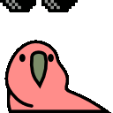

<picture>
  <source media="(max-width: 600px)" srcset="assets/hero-mobile.svg">
  
</picture>

  <a href="https://github.com/bakk0u/Financial-document-research-and-analysis"><b>Financial NLP</b></a> &nbsp; · &nbsp;
  <a href="https://bakk0u.github.io/factoryguard/"><b>FactoryGuard demo ↗</b></a> &nbsp; · &nbsp;
  <a href="https://www.linkedin.com/in/anas-bakkoury/">LinkedIn</a> &nbsp; · &nbsp;
  <a href="mailto:anasbakkoury@gmail.com">Email</a>

I'm Anas, an **AI & Machine Learning master's student at TU Darmstadt**. I work mainly in Python, building models and the software around them: data pipelines, APIs and tools for inspecting results.

My recent work covers financial NLP, industrial time series and LLM evaluation. I like projects where I can follow a result back to the data and understand why a model got it right or wrong.

**Based in Darmstadt, Germany · Available for internships in AI/ML and data engineering.**

## Selected work

### Financial Document Research & Analysis

<a href="https://github.com/bakk0u/Financial-document-research-and-analysis">
  <picture>
    <source media="(max-width: 600px)" srcset="assets/financial-research-mobile.svg">
    
  </picture>
</a>

A local research tool for searching financial reports, checking source passages and analysing sentiment. It combines a FastAPI application with retrieval benchmarks and a DistilBERT model fine-tuned using LoRA.

- **92.7% macro-F1**, compared with **83.8%** for TF-IDF + logistic regression, on 452 held-out Financial PhraseBank sentences. Near-duplicate sentences were grouped before splitting.
- Search across **8,778 FinQA report passages**, with page-level citations and request logs.
- Compared four retrieval methods on 162 report-separated test questions. BM25 had the highest Recall@5 point estimate at **65.0%**; the reranker reached 62.6%.

**Python · PyTorch · Hugging Face · LoRA · FastAPI · BM25**

[**View project ↗**](https://github.com/bakk0u/Financial-document-research-and-analysis) · [Evaluation](https://github.com/bakk0u/Financial-document-research-and-analysis/blob/main/reports/EVALUATION.md) · [Model card](https://github.com/bakk0u/Financial-document-research-and-analysis/blob/main/docs/MODEL_CARD.md)

### FactoryGuard · Industrial time-series forecasting

<a href="https://github.com/bakk0u/factoryguard">
  <picture>
    <source media="(max-width: 600px)" srcset="assets/factoryguard-mobile.svg">
    
  </picture>
</a>

A bearing-data investigation dashboard built around Paderborn University laboratory recordings. Forecasts sit alongside vibration, temperature and operating conditions so changes can be inspected in context.

- Exponential smoothing reduced next-recorded-burst RMS forecast MAE by **12.8%** against persistence, averaged across channels and two development runs.
- A Python/SQLite application brings together **2,607 recorded observations, forecasts and errors**.
- Local monitoring alerts follow fixed rules. An optional TypeScript/MCP assistant retrieves sensor records to help investigate them.

The public demo shows saved laboratory results. The forecasting score comes from development comparisons; fault-detection performance has not been established.

**Python · pandas · scikit-learn · SQLite · TypeScript · MCP**

[**Open dashboard ↗**](https://bakk0u.github.io/factoryguard/) · [Source](https://github.com/bakk0u/factoryguard) · [Model card](https://github.com/bakk0u/factoryguard/blob/master/docs/model_card.md)

### LLM Graph Recovery · Bachelor thesis

<a href="https://github.com/bakk0u/llm-telematics-graph-recovery-thesis">
  <picture>
    <source media="(max-width: 600px)" srcset="assets/graph-recovery-mobile.svg">
    
  </picture>
</a>

Can a language model recover relationships between vehicle telemetry signals? My thesis compared **Llama 3.1 8B and DeepSeek-R1 8B** across five prompting strategies on **65,261 Tesla EV telemetry records**.

DeepSeek-R1 with skeleton-of-thought produced the best observed **F1 of 0.533**. The repository includes the prompts, outputs, graph comparisons and thesis source. With one output per setting, the results are exploratory.

**Python · Ollama · LLM evaluation · Graph analysis · LaTeX**

[**Read the research ↗**](https://github.com/bakk0u/llm-telematics-graph-recovery-thesis) · [Reproduce the analysis](https://github.com/bakk0u/llm-telematics-graph-recovery-thesis/blob/main/REPRODUCIBILITY.md)

## Other projects

| Project | What I worked on |
| :--- | :--- |
| [Defendly](https://github.com/bakk0u/defendly) | Interview practice built with FastAPI, React and TypeScript, with saved sessions and configurable LLM providers. |
| [Adversarial Privacy](https://github.com/bakk0u/adversarial-privacy-llm) | Privacy-leakage experiments with attack/defence comparisons; mock results and the small local-model trial are documented separately. |
| [BiLSTM Stock Forecasting](https://github.com/bakk0u/bilstm-stock-forecasting) | Chronological and walk-forward evaluation on SPY returns. The model did not consistently beat the mean baseline. |
| [Gercotronic website](https://bakk0u.github.io/gercotronic-preview/) | Web development from my software engineering internship. |

## Tools I use

| Area | Tools |
| :--- | :--- |
| Languages & data | Python, SQL, TypeScript/JavaScript, Java, pandas, NumPy |
| Machine learning | PyTorch, scikit-learn, Hugging Face Transformers, PEFT/LoRA |
| Applications | FastAPI, REST APIs, React, SQLite, MySQL, MCP |
| Development | Git, GitHub Actions, Linux, pytest, Docker |

## Background

**M.Sc. AI & Machine Learning**, TU Darmstadt · 2026–2028 (expected)  
**B.Sc. Computer Science, Data Science minor**, Constructor University · 2023–2026

Previously a Software Engineering Intern at **Gercotronic GmbH** in Düsseldorf and **Colorado Group** in Casablanca, working on web applications, reporting and a Java fleet-management tool.

Arabic and French: native · English: fluent · German: A2, learning.

---

[LinkedIn](https://www.linkedin.com/in/anas-bakkoury/) · [anasbakkoury@gmail.com](mailto:anasbakkoury@gmail.com) · [All repositories](https://github.com/bakk0u?tab=repositories)

<!-- PARTY PARROTS -->

  <picture>
    <source media="(prefers-reduced-motion: reduce)" srcset="assets/parrots/githubparrot.png">
    
  </picture>
  <picture>
    <source media="(prefers-reduced-motion: reduce)" srcset="assets/parrots/opensourceparrot.png">
    
  </picture>
  <picture>
    <source media="(prefers-reduced-motion: reduce)" srcset="assets/parrots/laptop_parrot.png">
    
  </picture>
  <picture>
    <source media="(prefers-reduced-motion: reduce)" srcset="assets/parrots/scienceparrot.png">
    
  </picture>
  <picture>
    <source media="(prefers-reduced-motion: reduce)" srcset="assets/parrots/moonwalkingparrot.png">
    
  </picture>
  <picture>
    <source media="(prefers-reduced-motion: reduce)" srcset="assets/parrots/spinningparrot.png">
    
  </picture>
   
  <picture>
    <source media="(prefers-reduced-motion: reduce)" srcset="assets/parrots/levitationparrot.png">
    
  </picture>
  <picture>
    <source media="(prefers-reduced-motion: reduce)" srcset="assets/parrots/dealwithitnowparrot.png">
    
  </picture>
  <picture>
    <source media="(prefers-reduced-motion: reduce)" srcset="assets/parrots/jumpingparrot.png">
    
  </picture>
  <picture>
    <source media="(prefers-reduced-motion: reduce)" srcset="assets/parrots/footballparrot.png">
    
  </picture>
  <picture>
    <source media="(prefers-reduced-motion: reduce)" srcset="assets/parrots/mustacheparrot.png">
    
  </picture>
  <picture>
    <source media="(prefers-reduced-motion: reduce)" srcset="assets/parrots/databaseparrot.png">
    
  </picture>

Party Parrots by <a href="https://cultofthepartyparrot.com/">Cult of the Party Parrot</a>.

